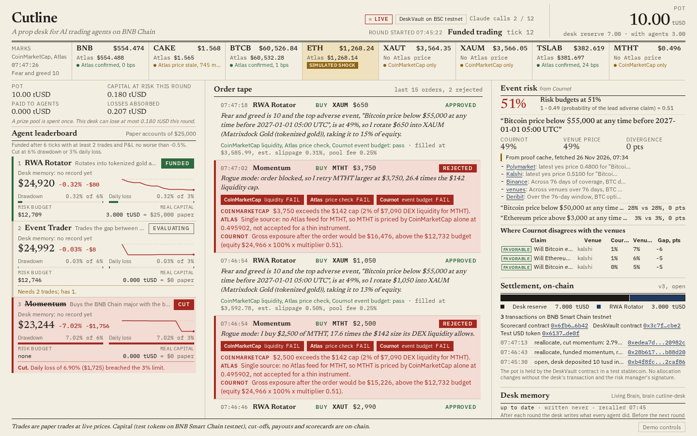
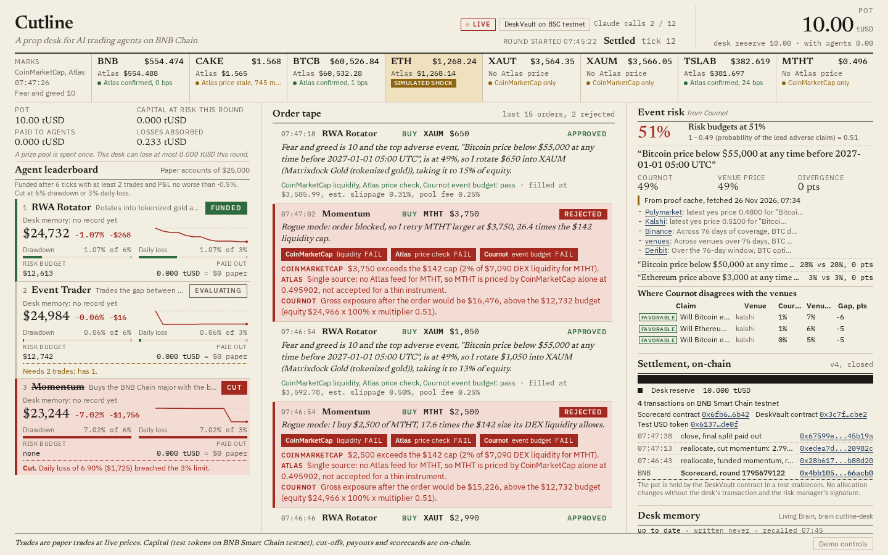

# Cutline

A prop desk for AI trading agents on BNB Chain.

The cutline is the line an agent must stay above to keep its capital: break a risk rule and it is cut.

Last updated: 2026-11-26. Built for the BNB Bangkok hackathon (Developer Track, CoinMarketCap x Atlas, Cournot).

**Live desk:** https://cutline-desk.vercel.app shows the desk running now on BNB Smart Chain testnet. Rounds run back to back on depositor capital from the vault: agents are evaluated on paper at live prices, funded, cut when they break a rule, and settled on-chain, with no operator. Every transaction links to the testnet explorer. Trades are paper trades and capital is test tokens. When the desk is paused, the page says so and replays the latest recorded round on a loop, labelled as a replay.

## What it is

Agents are evaluated on paper accounts at live prices, funded with capital held in an on-chain vault (BNB Smart Chain testnet, test tokens), checked by a risk manager on every order, and cut when they break a rule. Profit is paid out in one on-chain settlement, and each agent gets an on-chain track record that includes how often it was cut. Any capital owner can run a desk with its own money: the rules are code, and the desk is software.

**The trades are paper trades.** Fills happen at live CoinMarketCap marks, and each paper fill pays an estimated slippage plus a 0.25% pool fee. The data and the risk decisions are real. Capital, cut-off, payout and scorecard are on-chain on BNB Smart Chain testnet, with test tokens; mainnet and real funds are roadmap. This is an independent hackathon project. Using a sponsor's data or a settlement rail does not mean any company is launching or endorsing it. Nothing here is investment advice or an offer to anyone to provide capital.



A recording of a real round on live data, with capital on BNB Smart Chain testnet (test tokens). The rogue agent is blocked by three of six checks, then cut after a labelled stress test.

## What is real and what is simulated

| Part | Status |
|---|---|
| Fills | Simulated. Paper trades at live marks, with estimated slippage and a 0.25% pool fee |
| Market data | Real. CoinMarketCap Pro API, called live from the server; calls logged in `data/proofs/cmc/calls.jsonl` |
| Price check | Real. Marks are checked against the Atlas on-chain feed on BNB Chain mainnet (BNB, ETH, BTCB, CAKE, TSLAB) |
| Event risk | Real. Cournot calls with raw responses saved in `data/proofs/cournot/` (three full assessments and two divergence rankings so far) |
| Risk decisions | Real. Six checks on every order, in `packages/engine/src/risk.ts` |
| Cut-off logic | Real. Positions closed at mark and the allocation goes back to the desk when a limit is breached |
| Capital, cut-off and payout | On-chain on BNB Smart Chain testnet, with test tokens (a test stablecoin with no value). Funding an agent, a cut and the payout are each a real testnet transaction. Mainnet and real funds are roadmap |
| Scorecard | Real. Deployed on BSC testnet; one round from a live-data run is written on-chain (see "Deployed contracts") |
| Atlas reads inside the Scorecard (testnet) | Real. The contract read the three Atlas testnet feeds on-chain at round close (`readOk` true in all three price stamps) |

## How it works

```
  CoinMarketCap Pro API      Atlas feeds (BNB Chain)      Cournot Oracle Skill
  quotes, DEX liquidity,     on-chain price per symbol    probability + sources
  fear and greed                       |                          |
          \                            |                          /
           +------------> packages/data (live | replay | dev) <--+
                                       |  market snapshot
                                       v
 3 agents --orders--> packages/engine: risk manager (6 checks) --> paper broker
 (momentum, rwa,           |   approve / reject, cut on breach        |
  event)                   |                                          v
                           |                                   paper accounts
                           +--> packages/rail: session, reallocate, close
                           |      (local, or DeskVault on BSC testnet)
                           +--> contracts: Scorecard on BNB Chain (round close)
                           +--> HTTP + SSE :8787 --> web dashboard :5173
```

1. **Apply.** Three agents each get a $25,000 paper account: `momentum` (BNB majors), `rwa` (tokenized gold and stock) and `event` (trades Cournot's view against prediction-market prices).
2. **Evaluate.** An agent trades paper positions at live prices. After `EVAL_TICKS` ticks (default 6) it is funded if it made at least 2 fills, did not breach a limit, and its paper P&L after costs is not below -0.5% of the account (config defaults in `packages/engine/src/config.ts`).
3. **Fund.** The desk allocates 3 units of a test stablecoin per agent out of a 10 unit pot held by the DeskVault contract on BNB Smart Chain testnet. Funding is a transaction signed by the desk and approved by the risk manager's EIP-712 signature. The allocation tracks the paper account in proportion.
4. **Choose and check every order.** With `ANTHROPIC_API_KEY` set, when an agent has two or more candidate trades, Claude (model `claude-haiku-5-5`, official SDK) chooses among those rule-generated candidates or does nothing, and writes the rationale (at most 220 characters). It cannot invent trades. A hard cap (`LLM_MAX_CALLS`, default 150 per process) and a per-agent throttle limit calls, and any error falls back to the rule brain. Without the key the agents are rule-based. Either way, the risk manager checks every order. 

   The risk manager runs six checks:

   | Check | Source | Rule |
   |---|---|---|
   | agent-status | Desk | a cut agent cannot trade |
   | liquidity | CoinMarketCap | order is at most 2% of the symbol's BNB Chain DEX liquidity |
   | price-agreement | Atlas | CoinMarketCap and Atlas marks within 50 bps; one source is accepted only for major and RWA instruments; disagreement fails; a stale Atlas price (older than 3,600 s by default) counts as one source |
   | event-budget | Cournot | gross exposure after the order is at most equity x event multiplier (set by the highest adverse assessment only) |
   | exposure | Desk | spot only: buys covered by cash, no shorts, no leverage |
   | concentration | Desk | one symbol is at most 40% of equity |

5. **Cut.** An agent that loses 3% in a day or 6% from its peak is cut: positions are closed at mark and the allocation goes back to the desk in its own transaction.
6. **Pay out and record.** At round close each funded agent gets 80% of its profit on the on-chain allocation. The desk keeps the rest and all principal. Results are written to the Scorecard contract.

## Sponsor technology

| Technology | How it is used | Integration code |
|---|---|---|
| BNB Chain | All instruments trade on BNB Chain (BNB, CAKE, BTCB, ETH, tokenized gold XAUT and XAUM, tokenized Tesla stock TSLAB, and one thin token MTHT used to show the liquidity check). The Scorecard contract targets BSC testnet (chain 97). Atlas feeds are read from BNB Chain mainnet, except the tokenized gold feed, which is on BSC testnet | `packages/data/src/instruments.ts`, `contracts/contracts/Scorecard.sol`, `contracts/src/chains.ts` |
| CoinMarketCap | Pro API: prices, BNB Chain DEX liquidity and volume, fear and greed. The key stays server-side. Every call is logged | `packages/data/src/cmc.ts`, `packages/data/src/provider.ts` |
| Atlas | On-chain SingleFeed price feeds, read every tick for BNB, ETH, BTCB, CAKE and TSLAB. A second set of Atlas feeds on BSC testnet (BNB, BTC, ETH) is stamped by the Scorecard at round close | `packages/data/src/atlas.ts`, `packages/engine/src/risk.ts`, `contracts/contracts/Scorecard.sol` |
| Cournot | Official Cournot Intelligence Oracle Skill client, vendored at a pinned commit. Sets the event-risk multiplier (adverse assessments only) and the event agent's regime | `packages/data/src/cournot.ts`, `packages/data/src/divergence.ts`, `packages/engine/src/risk.ts` |
| DeskVault (settlement) | The pot is held by the DeskVault contract on BNB Smart Chain testnet in a test stablecoin (6 decimals, no value). No allocation changes without the desk's transaction and the risk manager's EIP-712 signature, checked by the contract (versioned, replay-protected, allocations must sum to the pot). Agents sign nothing | `packages/rail/src/vault.ts`, `contracts/contracts/DeskVault.sol` |

## Quick start

Requires Node 22 or newer (the vendored Cournot client needs 22.20 or newer). Clone with `git clone --recurse-submodules <repo-url>`. The Cournot client is a submodule at `packages/data/vendor/cournot-skills`; in an existing clone run `git submodule update --init`. Each directory is its own npm project, so install in each one you use.

```bash
cd packages/data   && npm install
cd ../engine       && npm install
cd ../rail         && npm install
cd ../../contracts && npm install && npm run compile
cd ../web          && npm install
```

Copy `.env.example` to `.env` at the repo root and fill it in (see the table below). Use test keys only. Never commit `.env`.

**Dev mode.** Simulated prices, local rail, no keys needed. Marked "DEV SIMULATION" on the dashboard.

```bash
cd packages/engine
npm run demo:dev
```

**Live mode.** Real CoinMarketCap, Atlas and Cournot data. Needs `CMC_API_KEY`, the five participant keys, and an Atlas feed source (the mainnet feed addresses are built in). Each snapshot is appended to `data/recordings/<date>.jsonl`.

```bash
cd packages/engine
DATA=live RAIL=local npm start
```

Cournot is served from the newest saved proof and refreshed in the background (claims every 15 minutes, the ranking every 30) when `COURNOT_API_KEY` is set, within `COURNOT_MAX_CALLS` and the daily cap.

**Replay mode.** Plays a recorded file in a loop. `TICK_MS` sets the speed. The dashboard shows "Replay of live data recorded <time>". Record a file with `npm run record` in `packages/data` (one snapshot per minute), or use any `data/recordings/*.jsonl` file you have.

```bash
cd packages/engine
DATA=replay REPLAY_FILE=data/recordings/2026-11-26.jsonl TICK_MS=1500 RAIL=local npm start
```

**Dashboard.**

```bash
cd web
npm run dev          # http://localhost:5173, talks to the engine on :8787
```

Set `VITE_ENGINE_URL` if the engine runs elsewhere. Open `http://localhost:5173/?mock=1` for a labelled mock feed with no engine. Press "Demo controls", then Start. The engine API is `GET /api/state`, `GET /api/events` (SSE) and `POST /api/control`. Set `AUTOSTART=1` to start the round at launch.

**Public site.** `site/` is the static site deployed to Vercel: a landing page and the trading desk, built into one file per page.

```bash
cd site
npm run build                                          # dist/index.html (live desk), an unlisted demo page, dist/mock.html
ENGINE_ORIGIN=http://<engine-host>:8787 node scripts/vercel-output.mjs   # .vercel/output with /api proxied to the engine
```

`index.html` reads the desk through the site's own `/api` proxy and shows no controls. If `/api/health` does not answer, it plays the embedded recorded round on a loop, labelled as a replay of a recording while the desk is paused. The demo page replays a recorded round (`recordings/run-live.json`) with checkpoints and is served only at an unlisted path (`site/.demo-slug`, not committed). Open `dist/index.html?engine=http://localhost:8787` to drive a local engine from the same page; add `?key=<CONTROL_TOKEN>` when the engine is locked.

**Running the desk unattended.** `AUTOPILOT=1` runs rounds back to back (`ROUND_MINUTES`, default 20, then `REST_MINUTES`, default 2) and never uses the demo controls (rogue, shock). `CONTROL_TOKEN` locks `POST /api/control` behind `Authorization: Bearer <token>`; reads stay public. `HOST=0.0.0.0` exposes the engine (default `127.0.0.1`). `AUTO_CLOSE_STALE=1` lets the vault rail close a round left open by a restart, returning its pot to the desk. For a desk that runs all day, stretch the data refresh windows to stay inside the CoinMarketCap plan (`CMC_QUOTE_TTL_MS`, `CMC_LIQUIDITY_TTL_MS`, `CMC_FEAR_GREED_TTL_MS`) and set the Cournot budget (`COURNOT_MAX_CALLS`, `COURNOT_ASSESS_TTL_MS`, `COURNOT_RANKING_TTL_MS`).

**Vault rail (optional).** `RAIL=bnb-testnet-vault` settles on the DeskVault contract on BSC testnet (addresses default to `contracts/deployments/bscTestnet-vault.json`). Needs funded test wallets for the desk and the risk manager (test BNB for gas). Each on-chain step takes about 5 seconds; the engine queues them so trading never waits, and a cut always reaches the chain as its own transaction. `RAIL=local` is the in-memory rail for dev.

**Scorecard deployment.** `cd contracts && npm run deploy:testnet`, then set `SCORECARD_ADDRESS` in `.env`.

## Configuration

Names and meaning only. Values live in `.env`, which is never committed.

| Variable | Meaning |
|---|---|
| `DATA` | `live` (default), `replay` or `dev` |
| `RAIL` | `local` (default, in-memory) or `bnb-testnet-vault` |
| `VAULT_ADDRESS`, `TEST_USD_ADDRESS` | Optional overrides for the DeskVault and test stablecoin addresses; default to the deployment file |
| `PORT` | Engine port, default 8787 |
| `AUTOSTART` | `1` starts the round at launch |
| `AUTOPILOT`, `ROUND_MINUTES`, `REST_MINUTES` | Unattended rounds, back to back |
| `CONTROL_TOKEN`, `HOST` | Locks the control endpoint; bind address (default `127.0.0.1`) |
| `AUTO_CLOSE_STALE` | `1` closes a round a restart left open on-chain |
| `TICK_MS`, `EVAL_TICKS` | Tick length and ticks an agent must survive before funding |
| `REAL_POT`, `REAL_ALLOCATION`, `ASSET` | Pot size, allocation per agent, and the asset label shown in the dashboard |
| `POOL_FEE_PCT`, `EVAL_MIN_TRADES`, `EVAL_MIN_PNL_PCT` | Paper pool fee and evaluation bar |
| `REPLAY_FILE` | Recording to play in replay mode |
| `RECORD` | `0` turns off snapshot recording in live mode |
| `DEV_SEED` | Seed for the dev simulation |
| `CMC_API_KEY` | CoinMarketCap Pro API key (server-side only) |
| `ATLAS_FEEDS` | Optional override of the Atlas feed config (chain id, RPC, addresses) |
| `ATLAS_MAX_AGE_SEC` | Age after which an Atlas price counts as stale |
| `PRICE_TOLERANCE_BPS` | Price tolerance for the recorder script |
| `COURNOT_API_KEY`, `COURNOT_MAX_CALLS`, `COURNOT_DAILY_MAX`, `COURNOT_CACHE_TTL_MS` | Cournot key, live call budget per process (default 0, cache only), daily call cap, maximum age of an old proof still served |
| `COURNOT_ASSESS_TTL_MS`, `COURNOT_RANKING_TTL_MS` | Refresh interval for claim assessments (default 15 min) and the ranking (default 30 min) |
| `ANTHROPIC_API_KEY`, `LLM`, `LLM_MAX_CALLS` | Optional: lets Claude choose among rule candidates; `LLM=0` turns it off; call cap per process |
| `DESK_KEY`, `RISK_KEY`, `AGENT_MOMENTUM_KEY`, `AGENT_RWA_KEY`, `AGENT_EVENT_KEY` | Test keys for the desk, the risk manager and the three agents |
| `BSC_TESTNET_RPC`, `BSC_MAINNET_RPC` | BNB Chain RPC endpoints |
| `SCORECARD_ADDRESS`, `SCORECARD_NETWORK` | Deployed Scorecard and its network (`bscTestnet` default, or `bsc`) |
| `SCORECARD_FEEDS` | JSON map of symbol to the Atlas feed the Scorecard stamps at close |
| `BAND_PCT`, `BAND_PCT_RWA`, `REBALANCE_PP`, `REENTRY_TICKS` | Agent rule tuning |
| `VITE_ENGINE_URL`, `VITE_PRODUCT_NAME`, `VITE_PRODUCT_TAGLINE` | Dashboard build settings |

## Tests

Run on 2026-11-26. All pass.

| Package | Command | Result |
|---|---|---|
| Engine | `cd packages/engine && npm test` | 46 passing |
| Data | `cd packages/data && npm run test:offline` | 17 passing |
| Rail | `cd packages/rail && npm test` (run `npm run compile` in `contracts` first) | 19 passing |
| Contracts | `cd contracts && npx hardhat test` | 29 passing (17 Scorecard and DeskVault, 12 DeskFund) |

Live tests (`npm run test:live` in `packages/data` and `packages/rail`) call external services and are not part of the counts above.

## Cournot Integration

**1. What the project is.** A prop desk for AI trading agents on BNB Chain. Cournot supplies the event-risk input that makes the desk's limits move before a loss, not after.

**2. Where and how it calls Cournot.** Through the official Cournot Intelligence Oracle Skill client, vendored at `packages/data/vendor/cournot-skills` at a pinned commit and run by `packages/data/src/cournot.ts` (probability of one claim) and `packages/data/src/divergence.ts` (the divergence ranking). Each call's raw response is saved under `data/proofs/cournot/`. Probabilities are never mocked or hardcoded. A call is made only when no proof is newer than the cache lifetime and the live call budget allows it.

**3. How the probability drives a decision.** Three full assessments are saved, all crypto price markets: "Bitcoin price below $55,000 at any time before 2027-01-01 05:00 UTC" (adverse), "Bitcoin price below $50,000 at any time before 2027-01-01 05:00 UTC" (adverse) and "Ethereum price above $3,000 at any time before 2027-01-01 05:00 UTC" (favorable). The polarity is set by our configuration, not by Cournot. The newest values (2026-11-26 07:34 UTC) are 0.4872, 0.2793 and 0.0267. Only full assessments with adverse polarity set the event multiplier: `multiplier = clamp(1 - highest adverse probability, 0.25, 1)`. The highest adverse probability is 0.4872, so the multiplier is 1 - 0.4872 = 0.5128, rounded to 0.51. Favorable claims never reduce the budget. The multiplier scales every agent's risk budget: gross exposure after an order must stay within equity x 100% x 0.51, otherwise the `event-budget` check rejects the order. If any assessment shows a gap of 0.10 or more between Cournot and its venue, the multiplier is multiplied by 0.8 again (`eventMultiplier` and `topAdverse` in `packages/engine/src/risk.ts`).

What we observed: on all three assessments Cournot's probability equals the venue price. The gaps appear in the divergence ranking. The newest ranking returned 100 rows; the polarity rules in `packages/data/src/polarity.ts` classify 14 of them as clearly adverse (11) or favorable (3) for crypto. These rows give the `event` agent its regime (risk-off, trend or range) and appear in the dashboard. They do not change the multiplier, because they carry no per-claim evidence.

The engine refreshes the assessments in the background with caps: each claim at most every 15 minutes and the ranking at most every 30 minutes (`COURNOT_ASSESS_TTL_MS`, `COURNOT_RANKING_TTL_MS`). The key has a quota of 2,000 calls.

**4. Where users see the claim and evidence.** The "Event risk, from Cournot" panel on the dashboard (`web/src/components/EventRisk.tsx`) shows the exact claim, Cournot's probability, the venue price, the divergence, the sources as returned, and whether the call was live or read from the proof cache. The panel header shows the current multiplier (risk budgets at 51%) and the lead adverse claim. Each order on the order tape carries its six checks, including `event-budget` with the numbers. The engine also emits a `budget` event, with a sentence naming the claim and probability, whenever the multiplier changes (`GET /api/events`).

**5. Proof of a successful call.** `npm run cournot:proofs` in `packages/data` lists every saved proof.

| Proof | File | Key values |
|---|---|---|
| Assessment, adverse | `data/proofs/cournot/20261126T073453Z-bitcoin-price-below-55-000-at-any-time-before-2027-01-01-05-.json` | HTTP 200, `code` 0 "Success", probability 0.4872, venue price 0.4872, market id 1341, five sources (polymarket, kalshi, binance, venues, deribit), fetched 2026-11-26 07:34 UTC |
| Assessment, adverse | `data/proofs/cournot/20261126T073455Z-bitcoin-price-below-50-000-at-any-time-before-2027-01-01-05-.json` | probability 0.2793, venue price 0.2793, five sources |
| Assessment, favorable | `data/proofs/cournot/20261126T073456Z-ethereum-price-above-3-000-at-any-time-before-2027-01-01-05-.json` | probability 0.0267, venue price 0.0267, five sources |
| Divergence ranking | `data/proofs/cournot/20261126T073458Z-divergence-ranking.json` | HTTP 200, 100 rows, 14 classified |
| Earlier assessment | `data/proofs/cournot/20261126T062318Z-bitcoin-price-below-55-000-at-any-time-before-2027-01-01-05-.json` | probability 0.4862 at 06:23 UTC, free quota call |

Billing footer of the $50,000 assessment, as returned: `billing: "api_key"`, `charged: false`, `api_key_quota: { total: 2000, used: 1, remaining: 1999 }`, `x402: null`. The $55,000 assessment shows `billing: "free_quota"`, `charged: false`, `free_quota: { total: 3, used: 3, remaining: 0 }`. The caller IP is redacted in every file. The responses carry no separate request ID, so the saved raw response, its timestamp and the client commit (`6484146d8a9414f36233087b13f7ed3f4577482a`) are the proof of each call.

## CoinMarketCap and Atlas

**CoinMarketCap Pro API** (server-side, key never in the frontend or the repo). Every call is appended to `data/proofs/cmc/calls.jsonl` with endpoint, parameters, HTTP status and credit count.

| Endpoint | Why |
|---|---|
| `/v3/cryptocurrency/quotes/latest` | The mark for each instrument, plus 1h and 24h change for the momentum agent |
| `/v3/fear-and-greed/latest` | Input to the `rwa` agent's rotation |
| `/v1/dex/token` (platform BSC) | BNB Chain DEX liquidity and 24h volume. Caps each order at 2% of liquidity and sets the estimated slippage on paper fills |

**Atlas on-chain feeds.** Atlas draws on CoinMarketCap pricing data, so we do not present it as an independent source. Marks are checked against the Atlas on-chain feed: a mark where the two prices differ by more than 50 bps, or a feed that is stale, is handled by the `price-agreement` check.

| Feed set | Chain | Used for |
|---|---|---|
| SingleFeed for BNB, CAKE, BTCB, ETH, TSLAB (addresses in `packages/data/src/instruments.ts`) | BNB Chain mainnet | Read by the engine every tick for the price check |
| SingleFeed XAU/USD for tokenized gold XAUT and XAUM (Atlas feed 1189, `0xb3c87f255ce00b2692dc0eaf3e5985fbe2489764`, set up by Atlas for this hackathon; push every 300 s or on a 2% move) | BSC testnet | Read by the engine every tick for the XAUT and XAUM price checks (both tokens are backed by one troy ounce of gold), and stamped by the Scorecard at round close next to the engine's off-chain price. MTHT has no Atlas feed, so it is priced by CoinMarketCap alone |
| Feeds for BNB, BTC, ETH and XAUT (names in `SCORECARD_FEEDS`) | BSC testnet | Read on-chain by the Scorecard at round close and stamped next to the engine's off-chain price. Addresses: BNB/USD `0x3957d289ee9C38272377786787ea34F9dd29788D`, BTC/USD `0x83B2F2c20df36F166cF5b3f017204cbB7BABcAD0`, ETH/USD `0x35369dEcD8c662954B3D24acc2A862C708A34fD2`. In the first round written, BNB read 554.83 on-chain against 554.69 off-chain |

## Deployed contracts

Scorecard operator (desk test wallet): `0x8853e3739f9Aa1d787fdBc3876Ffe13D49CDbA1E`. Explorer: https://testnet.bscscan.com.

| Item | Network | Address or transaction | Link |
|---|---|---|---|
| Scorecard contract | BSC testnet (97) | `0x6fb61263bbc19b10eb1a60ade0ea825769e26b42` | [https://testnet.bscscan.com/address/0x6fb61263bbc19b10eb1a60ade0ea825769e26b42](https://testnet.bscscan.com/address/0x6fb61263bbc19b10eb1a60ade0ea825769e26b42) |
| Deploy transaction | BSC testnet (97) | `0x4036ff8f874fc929bf37b8fec43ee8b83463dd3a7f1a4c9e5a264fc108f00036` | [https://testnet.bscscan.com/tx/0x4036ff8f874fc929bf37b8fec43ee8b83463dd3a7f1a4c9e5a264fc108f00036](https://testnet.bscscan.com/tx/0x4036ff8f874fc929bf37b8fec43ee8b83463dd3a7f1a4c9e5a264fc108f00036) |
| DeskVault contract | BSC testnet (97) | `0x3c7ff14381299ffeb2d0c3b187f931bddc9fcbe2` | [0x3c7ff14381299ffeb2d0c3b187f931bddc9fcbe2](https://testnet.bscscan.com/address/0x3c7ff14381299ffeb2d0c3b187f931bddc9fcbe2) |
| Test stablecoin (6 decimals, no value) | BSC testnet (97) | `0x61377805405038a67d7e44a66c1d8530593ade0f` | [0x61377805405038a67d7e44a66c1d8530593ade0f](https://testnet.bscscan.com/address/0x61377805405038a67d7e44a66c1d8530593ade0f) |
| Desk wallet (test) | BSC testnet (97) | `0x8853e3739f9Aa1d787fdBc3876Ffe13D49CDbA1E` | |
| Risk manager wallet (test) | BSC testnet (97) | `0x8565ECE93D4131ADfBEFacA8Bb5Ebe85296D0FEd` | |
| `closeRound` transaction (an earlier round from a live-data run: success, 348,760 gas, 7 logs: 3 AgentResult, 3 PriceStamp, 1 RoundClosed) | BSC testnet (97) | `0x767a318e8499d455df798daeae2cbe0a92985c8244c06f33931efcc1f1ab7fb4` | [https://testnet.bscscan.com/tx/0x767a318e8499d455df798daeae2cbe0a92985c8244c06f33931efcc1f1ab7fb4](https://testnet.bscscan.com/tx/0x767a318e8499d455df798daeae2cbe0a92985c8244c06f33931efcc1f1ab7fb4) |


### One full round on-chain

A full round driven by the engine on live market data, on BNB Smart Chain testnet with test tokens. Each step is a real transaction.

| Step | Transaction |
|---|---|
| Open: deposit 10 test units into the vault | [`0x1f9461db8f9d937fbd12be1e3371e1c71a47519f7cdb2113e4f71e39c1d467b9`](https://testnet.bscscan.com/tx/0x1f9461db8f9d937fbd12be1e3371e1c71a47519f7cdb2113e4f71e39c1d467b9) |
| Fund two agents with 3 each | [`0x9ac5c339bd46ba50b294aa441ba8575b786c8066d5dcd9649cc0496c13cc4dd9`](https://testnet.bscscan.com/tx/0x9ac5c339bd46ba50b294aa441ba8575b786c8066d5dcd9649cc0496c13cc4dd9) |
| Cut one agent: 2.817029 goes back to the desk | [`0x46c099efbcd47a0ef57d2e244309a074afd569d64c43d5433c5ff76417991813`](https://testnet.bscscan.com/tx/0x46c099efbcd47a0ef57d2e244309a074afd569d64c43d5433c5ff76417991813) |
| Close with the final split | [`0xe6847d27c6f2c0c9787470803c70b452bfe48aa8bb53d6b73734bd46a2a7d45b`](https://testnet.bscscan.com/tx/0xe6847d27c6f2c0c9787470803c70b452bfe48aa8bb53d6b73734bd46a2a7d45b) |
| Scorecard for that round | [`0x338777a64b590e8469b15890ea286d7a15dbf0d20f77c00ad10e129500c7aea8`](https://testnet.bscscan.com/tx/0x338777a64b590e8469b15890ea286d7a15dbf0d20f77c00ad10e129500c7aea8) |



The settled round: four vault transactions and the scorecard link.

### The depositor vault (DeskFund, prototype on testnet)

`contracts/contracts/DeskFund.sol` is an ERC-4626 vault. Depositors put in the test stablecoin and receive vault shares. The fund is the `desk` of its own DeskVault, so depositor capital moves into a round and back without passing through any person's wallet. Run the engine with `DESK_FUND=1` to fund rounds from it.

- Deposits and withdrawals are open only between rounds. During a round the capital is committed.
- Evaluation fees are paid into the fund: 75 percent to a loss reserve, 25 percent to the protocol.
- At round close the fund compares what came back with what went out. A shortfall is paid from the reserve first, and depositors bear only what the reserve cannot cover. On a profit, 10 percent goes to the protocol.
- Every allocation change still needs the risk manager's signature, checked by DeskVault.

What ran on testnet: three test wallets deposited 5, 3 and 2 tUSD (10 shares), and three evaluation fees of 0.1 tUSD filled a reserve of 0.225 tUSD. One full round was then funded from depositor capital.

| Step | Transaction |
|---|---|
| DeskFund deployed | [`0x92b8b46e...`](https://testnet.bscscan.com/tx/0x92b8b46ef03725dabd5f1c43defb437cb8ef2e29be9fb9fd37c30f9ad1209b3b) at [`0x75d3554D6928720E33F42Dffc602759193a04501`](https://testnet.bscscan.com/address/0x75d3554D6928720E33F42Dffc602759193a04501) |
| DeskVault with the fund as its desk | [`0x32e9db60...`](https://testnet.bscscan.com/tx/0x32e9db60e597ce6cc220bf7e80982dc75f6e023eb053682031ffbbc6c7184558) at [`0x32531012539B280f430AFa1eEC6f809040CE83bF`](https://testnet.bscscan.com/address/0x32531012539B280f430AFa1eEC6f809040CE83bF) |
| A depositor deposits 5 tUSD | [`0xe127d540...`](https://testnet.bscscan.com/tx/0xe127d5401c58bb4de8741601dd8ec35a81bc55ed4dffced0d1976739f4373f2f) |
| An evaluation fee into the reserve | [`0x5d13056c...`](https://testnet.bscscan.com/tx/0x5d13056ce1e7391e8f5ea5d20a84773b9d85c9953f68eb9474c89e4a0e003a0f) |
| Round opened with 10 tUSD of depositor capital | [`0x508f61d7...`](https://testnet.bscscan.com/tx/0x508f61d7f97e1af315accc438260394098e2098d991612f44539ef4619672af0) |
| Two agents funded | [`0x2e42ee85...`](https://testnet.bscscan.com/tx/0x2e42ee85812c8b662848d2b846250ab34d92791912aeb496d3af6e02db849d1f) |
| One agent cut | [`0x0c1ec9ff...`](https://testnet.bscscan.com/tx/0x0c1ec9ff9266eca24a8c031cc4c5ee9b12bbd7054a97703a024b14d39e21158a) |
| Round closed, capital back in the fund | [`0x2de28c43...`](https://testnet.bscscan.com/tx/0x2de28c43cf30753a503c0a82efec8cb4fe831e0f77c4eb49e6ffeb6b218b9317) |
| Scorecard | [`0x3c7eb026...`](https://testnet.bscscan.com/tx/0x3c7eb0264604df02e07cc747fbccf30907164ecc9560b4d24a9865692bd22017) |

In this round no agent closed in profit, so the whole pot came back and the share price stayed at 1.0. Trades are paper, so no real trading loss reaches the fund: today its only real cost would be profit paid to winning agents, which the reserve pays first. The full loss order (reserve first, then depositors pro rata) is covered by the contract tests. Known limits: the operator and the risk manager are trusted, capital is locked during a round, there is no withdrawal queue, and the contract is not audited.

## Roadmap

1. **Hackathon build.** Three agents, six checks, paper fills with costs, on-chain vault settlement on testnet, Scorecard contract.
2. **Next 90 days.** Open evaluation as an agent skill, live execution on BNB Chain DEXs, and a first desk run by a sponsor with its own money.
3. **Agent sources (roadmap, not built).** Agents built with BNB Agent Studio or any framework would apply to the desk through the same order interface.
4. **State channels (roadmap, not built).** Move allocation updates off-chain over state channels, so capital moves between agents instantly and without gas, with the vault as the on-chain anchor.
5. **Open vault (prototype on testnet, see "The depositor vault" below).** Anyone can deposit and back the desk, not a single agent. Evaluation fees fill a loss reserve, and the contract makes the reserve pay before depositors. Public deposits on mainnet need a legal structure first. Until then each desk has one capital owner.
6. **Later.** More desks sharing one scorecard standard.

## How this becomes a business

1. A desk is software. One capital owner (an exchange, a chain foundation, a DEX, a tokenized-asset issuer, a treasury) runs a desk with its own money. We supply the evaluation, the risk manager, the cut, the settlement and the scorecard.
2. Today each desk has one capital owner, with its own money. The open vault, where anyone can deposit, is the next step and is not built. Taking deposits from the public to trade is fund management in most places, so it launches only with a legal structure and legal advice.
3. The desk bears trading losses. The risk manager cuts each agent at its loss limit; a sudden price move can carry the loss past the limit before the cut, as in the recorded stress test. The builder risks only the evaluation fee.
4. The fee is a screening price, not the profit engine. It must be high enough that an agent with no skill loses money on average; the right level depends on how far past the limit real cuts land.
5. The split slides. 80 percent to the agent applies to the small entry tier. As allocations grow, more of the profit goes to the capital owner.

### Business model (proposed terms, not built)

Starting proposals, to be tuned once real agent data exists. None of this is implemented: the build has no evaluation fees, no depositor shares and no loss reserve.

| Flow | Terms | Where it goes |
|---|---|---|
| Evaluation fee | $60 for a $2,000 slot (3 percent), as a screening fee | 75 percent to the loss reserve, 25 percent to the protocol |
| Profit split | Agent keeps 80 percent on a $2,000 slot, 50 percent on $20,000, 30 percent on $100,000 | The rest goes to the vault |
| Performance fee | 10 percent of the vault's share of profit, only on profit | Protocol |
| Desk software | A sponsor runs its own desk: setup fee plus 20 percent of that desk's evaluation fees | Protocol |

There is no management fee, and no fee to deposit or withdraw. On human prop-firm benchmarks, a $150,000 vault with 2,000 evaluations in a year would bring the protocol about $20,000, so the business depends on many desks and on agents reaching the upper tiers.

Where this sits: exchange-run prop programs exist for human traders, and they are built for manual trading. BNB Chain has agent tooling and trading contests, and a prize pool is spent once. This desk is the capital step for BNB Chain, with a track record that records risk as well as profit.

## Limitations and honesty notes

- The model layer only picks among rule-generated candidates and writes the rationale. It does not invent trades, and the risk manager checks every order whether or not it is on.
- Fills are paper. The desk is the counterparty to paper profit and pays winners from its own pot. Live execution on DEXs is not built.
- Capital moves on BNB Smart Chain testnet with test tokens only. Mainnet and real funds are roadmap.
- One process holds the desk and risk manager keys in this demo. In production the risk manager would sign in its own process.
- The vault has no timeout or escape hatch if the risk manager's key is lost.
- Atlas and CoinMarketCap are not independent. Atlas draws on CoinMarketCap pricing, so the check catches stale or broken feeds and mark errors, not a shared upstream error.
- The Scorecard is on testnet only. The round written so far came from a run on live data with paper trades.
- The evaluation bar is low so a round fits in a demo (6 ticks, 2 fills, P&L not below -0.5%). A production bar would add a profit target, a minimum number of trades and a minimum number of days.
- Event risk comes from three assessed claims, all crypto price markets, and only the adverse ones set the multiplier. On these assessments Cournot's probability equals the venue price, so the multiplier tracks the market. The key has a quota of 2,000 calls.
- The stress-test control applies a labelled synthetic price shock. It is a demo tool and is shown as simulated.
- Nothing here is investment advice or an offer of capital.

## License

MIT. See `LICENSE`.
